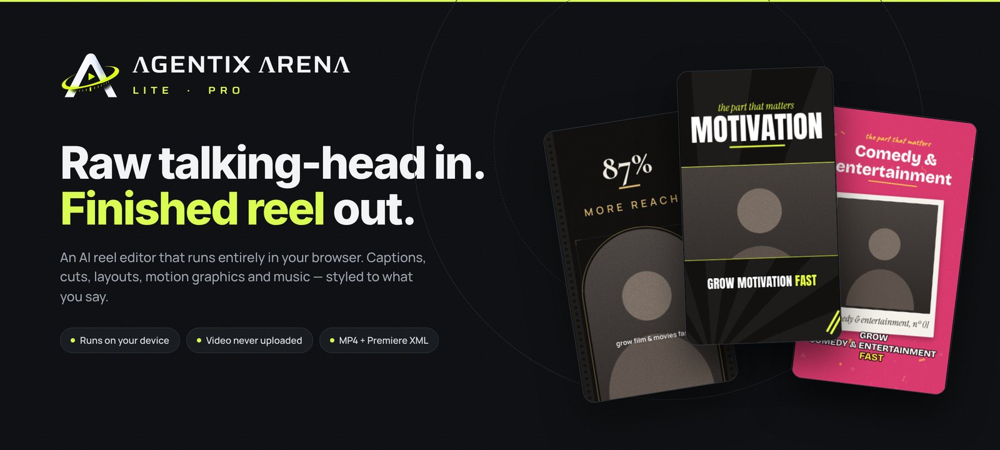
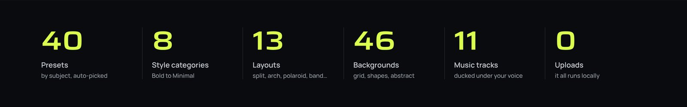
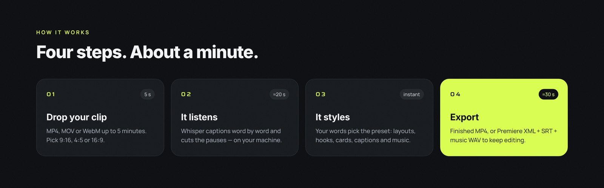
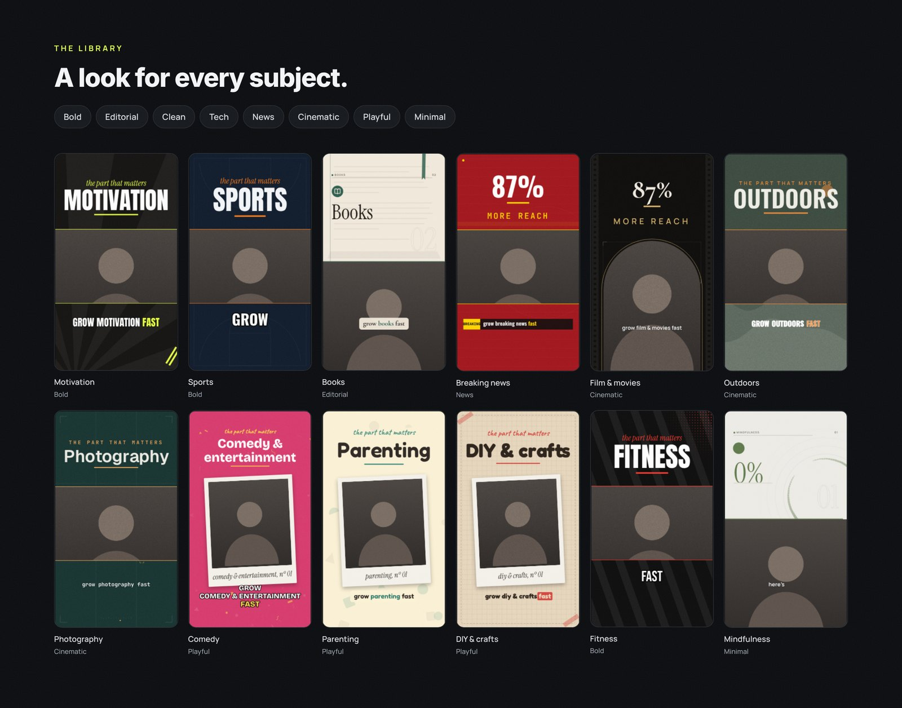
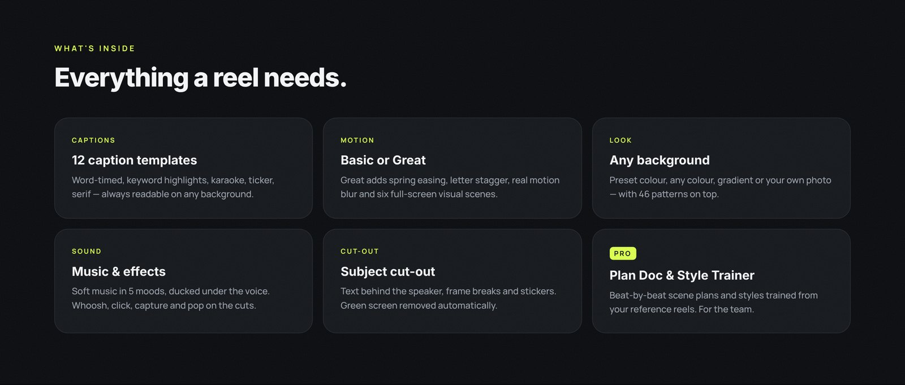
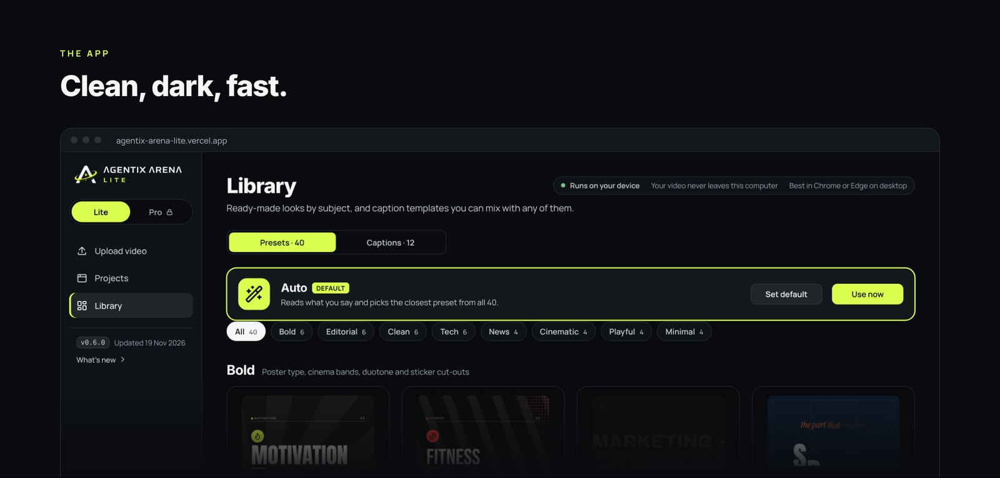

<p align="center">
  <a href="https://agentix-arena-lite.vercel.app"></a>
</p>

<p align="center">
  <a href="https://agentix-arena-lite.vercel.app"></a>
  &nbsp;
  
  &nbsp;
  
</p>

<p align="center"><b>Agentix Arena</b> turns a raw talking-head clip into a finished, styled reel — captions, pause cuts, layouts, motion graphics and music — entirely on your own device.<br>No login. No upload. Your video never leaves your computer.</p>

<p align="center"><a href="https://agentix-arena-lite.vercel.app"><b>agentix-arena-lite.vercel.app →</b></a></p>

<br>











## Lite and Pro

| | **Lite** | **Pro** |
|---|---|---|
| Who | Anyone with the link | The UGENTIC / Soaring Media team |
| Sign-in | None | Google or email (team domains) |
| What you get | Upload → styled reel → MP4, Premiere XML + SRT + music WAV | Everything in Lite, plus Plan Doc (beat-by-beat scene plans) and Style Trainer (styles from reference reels) |

## Built with

React 19 · TypeScript · Vite · WebCodecs (Mediabunny) · Whisper (transformers.js) · MediaPipe · three.js · Web Audio — all running in the browser. Hosted on Vercel.

<details>
<summary><b>For developers</b></summary>

### Develop

```bash
npm ci
npm run dev        # http://localhost:5173
npm run typecheck  # tsc -b, strict
npm run build      # copies MediaPipe WASM to public/mp, then vite build
```

Use desktop Chrome or Edge. Videos are limited to 5 minutes.

`vite.config.ts` and `vercel.json` set `Cross-Origin-Opener-Policy: same-origin` and `Cross-Origin-Embedder-Policy: credentialless`. They make the page cross-origin isolated, which unlocks multi-threaded WebAssembly for captions; `credentialless` keeps Google Fonts and the Hugging Face model CDN loading.

### How it works

| Step | How |
| --- | --- |
| Decode / encode | WebCodecs through Mediabunny (H.264 + AAC, Opus fallback) |
| Captions | Whisper through transformers.js in `src/lib/whisper.worker.ts` (`?cpu` forces WASM) |
| Cut-out and face | MediaPipe Tasks Vision |
| Pause cutting | Gaps over 0.42 s removed, 0.12 s padding kept |
| Style engine | Keyword lexicons pick a preset (`src/lib/packs.ts`); its group (`src/lib/looks.ts`) sets the layout mix |
| Render | One canvas renderer (`src/lib/render.ts`) for preview and export, so they always match |
| Sound | Music and effects synthesised with Web Audio (`src/lib/sound.ts`) |
| Storage | Projects in IndexedDB (`src/lib/db.ts`) |

### Release

- Work on a branch. Every push gets a preview deployment on Vercel (team `soaring-media`, behind Vercel login).
- **Pushing to `main` deploys to production.** Merge only after the product owner's explicit go-ahead.
- Bump `version` in `package.json` and `src/lib/version.ts` (`VERSION`, `RELEASED`, `WHATS_NEW`) together.
- Rollback: Vercel → Deployments → previous production deployment → Instant Rollback.

### Notes

- This repo was recovered on 18 Nov 2026 from the v0.5.0 preview deployment `dpl_2x2t8PQuNYhoJXohzY6LUECEREWE`, which was deployed as compressed chunks. The source is byte-identical to that build: `npm run build` produces `dist/assets/index-BTnaftN8.js`, the same bundle as the reviewed preview.
- `lucide` is locked at 1.73.0 in `package-lock.json`. A newer lucide changes the bundle; that is fine for new work, but check icons when you upgrade.
- Local QC pages from earlier builds (`lab.html`, `sound-lab.html`) were never deployed and are not in this repo.

</details>

<p align="center"><br><sub>Made by UGENTIC AI · Soaring Media</sub></p>
